<div align="center">

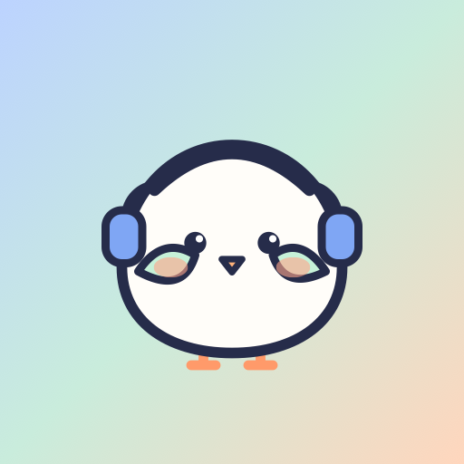

# The Coop

### Social media you can hear.

**A voice-first social network built for blind, low-vision and older people.**
Friends share *audio journeys* of where they went and how it felt. Coo, a friendly pigeon, reads them to you in their own voices, finds real news with sources, and helps you get things done, all by talking.

**[Open the app](https://thecoop-kappa.vercel.app)** · [Listen to a journey](#listen-first) · [Try it in 60 seconds](#try-it-in-60-seconds) · [How it works](#how-it-works) · [Run it yourself](#run-it-locally)


*Scan to open The Coop on your phone, then add it to your home screen. It installs like an app.*

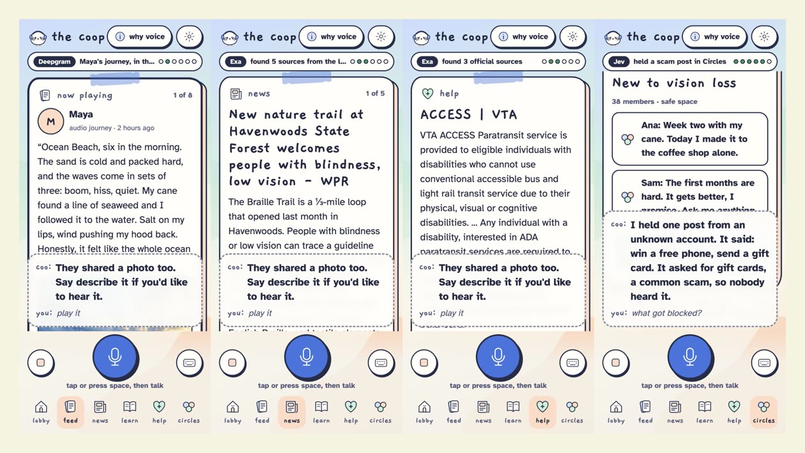

</div>

---

## Listen first

This README is written to work with a screen reader. Every image has a description, and here's the heart of the app as sound. These are real clips from the app, each friend in their own voice:

- 🌊 [**Maya at Ocean Beach, 6 a.m.**](docs/audio/maya-ocean-beach.mp3) *"The waves come in sets of three: boom, hiss, quiet."*
- 🏮 [**Lena at the lantern festival**](docs/audio/lena-lantern-festival.mp3) *"Paper rustling overhead like a thousand quiet birds."*
- 🦉 [**Omar's night hike**](docs/audio/omar-night-owl.mp3) *"My guide dog froze, and right above us came a long, breathy screech."*
- 🍅 [**Grandpa Joe's garden by feel**](docs/audio/grandpa-joe-garden.mp3) *"I find the tomato plants by smell before I touch them."*

## Why we built it

Most social media is a wall of pictures. With a screen reader, a photo usually just says *"image,"* and scrolling a feed by swiping is slow and tiring. Millions of people lose their sight later in life and never learn a screen reader at all.

So we flipped it. **On The Coop, the post *is* the sound.** Friends don't post photos with captions. They post journeys: where they went, what it sounded like, what it smelled like, how it felt. A photo is an optional extra for sighted friends, and Coo will describe it if you ask.

Talking is something everyone already knows how to do. That's the whole interface.

## Try it in 60 seconds

Open the app in **Chrome**, then tap the big mic or press the **space bar**. Coo says hi. Then just talk:

| Say | What happens |
|---|---|
| **"What's new?"** | Coo says who it's from, then Maya's journey plays **in her own voice** |
| **"Next"** | Skips to the next friend, even in the middle of a post |
| **"Like it"** · **"Reply: that sounds amazing"** | A chime, and it's on the post. Every reply is checked for scams first |
| **"Describe the photo"** | If a friend shared one, Coo looks at the real image and describes it |
| **"Go to news"** | One **real** story from the last 48 hours, with the outlet named out loud |
| **"More like this"** | Similar recent stories |
| **"How do I get rides in San Jose?"** | Official sources only: VTA ACCESS paratransit, from vta.gov |
| **"Free audiobooks"** | The Library of Congress talking-books service |
| **"Teach me to cook without sight"** | A beginner lesson, explained as three simple steps |
| **"Go to circles"** · **"What got blocked?"** | Small support groups, with scams held before anyone hears them |
| **"Play my feed"** | Hands-free mode: your whole feed, like a podcast |
| **"Where am I?"** · **"Help"** · **"Stop"** | Always available |

No microphone? Every voice command also works by typing, by tapping the chips on screen, or from the keyboard.

## Built for blind and low-vision people, first

- **Ears first.** Everything Coo shows, Coo says. Every screen has big, live captions too.
- **One voice at a time.** Coo goes silent while a friend's journey plays, so voices never talk over each other.
- **Works with your screen reader.** Turn on *"use my screen reader"* and Coo stays quiet while VoiceOver or TalkBack reads the live captions.
- **Keyboard everything:** <kbd>Space</kbd> talk · <kbd>→</kbd> next · <kbd>←</kbd> back · <kbd>D</kbd> describe · <kbd>L</kbd> like · <kbd>R</kbd> reply · <kbd>W</kbd> where am I · <kbd>H</kbd> help · <kbd>Esc</kbd> stop.
- **For low vision:** high contrast (yellow and white on black), text up to 160%, and a calm mode with no animation.
- **Real buttons** with labels, visible focus rings, 44-pixel touch targets, and nothing shown by color alone.
- **Never guesses who someone is** in a photo, and every fact comes with its source.
- **Safe by design.** Scams and harassment are held before anyone hears them, and Coo asks *"are you sure?"* before anything that sends, spends or calls.
- **Installs like an app.** On iPhone: open the link in Safari, then Share, then *Add to Home Screen*.

We'd design and test every screen of the real product with blind and low-vision people. It's built to work alongside VoiceOver and TalkBack, not to replace them.

## Sponsors, and what each one does

| Sponsor | What it powers | Status |
|---|---|---|
| **Vapi** | Coo herself: the voice assistant, 18 tools, the web mic, interruptions, phone calls | ✅ live |
| **Deepgram** | Coo's ears (Flux speech-to-text), Coo's voice and all 8 friends' voices (Aura-2), and transcripts of recorded voice posts | ✅ live |
| **Exa** | Real news from the last 48 hours, "more like this", help from official sites only, beginner lessons | ✅ live |
| **TypeSafe Jev** | Holds scams and harassment, the "are you sure?" check, and working out what you meant | 🧪 built; keyword rules stand in, labeled "sample", until our key is added |
| **Manus** | "Do it for me": web chores that are hard with a screen reader, always stopping for your yes | 🧪 built; a labeled sample run until our key is added |
| **AdaL** | Captioned share clips, so sighted friends can join in | 🧪 no public video API, so clips are made in the browser, labeled "sample" |
| **Claude** (not a sponsor) | Describes a shared photo and answers questions about it | ✅ live |

Anything not live says **"sample"** on screen and out loud. We'd rather show you that than fake it.

## Screens

| | | |
|:-:|:-:|:-:|
| 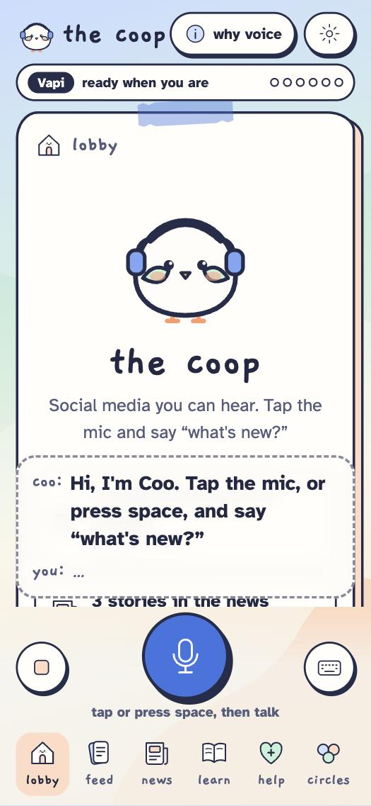<br>**Lobby** | 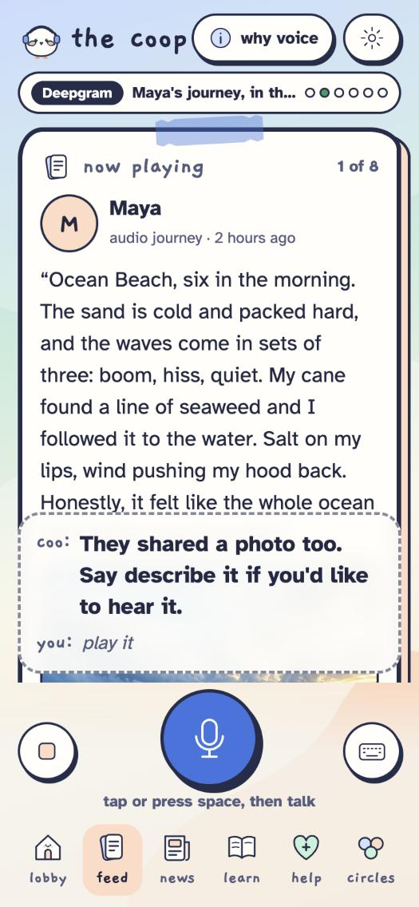<br>**An audio journey** | 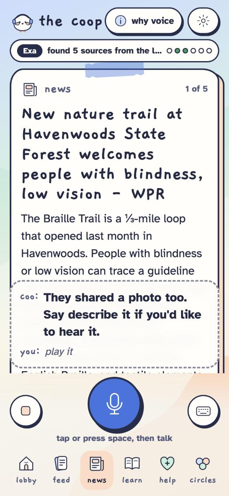<br>**Real news, with sources** |
| 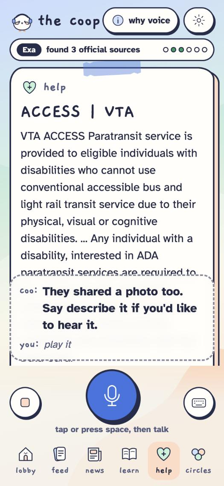<br>**Help from official sites** | 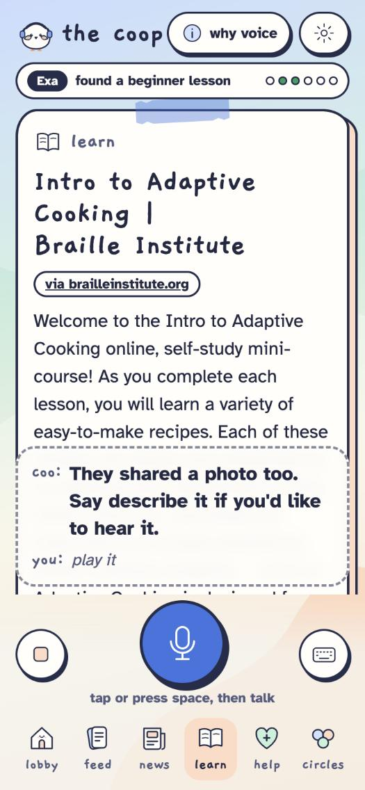<br>**Learn new skills** | 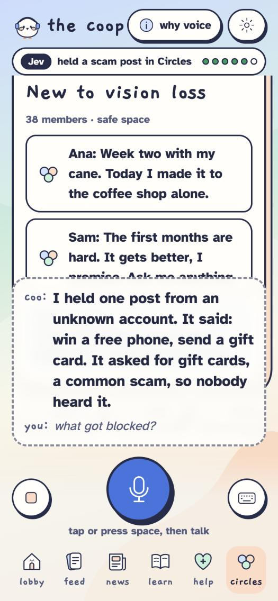<br>**Scams held in Circles** |
| 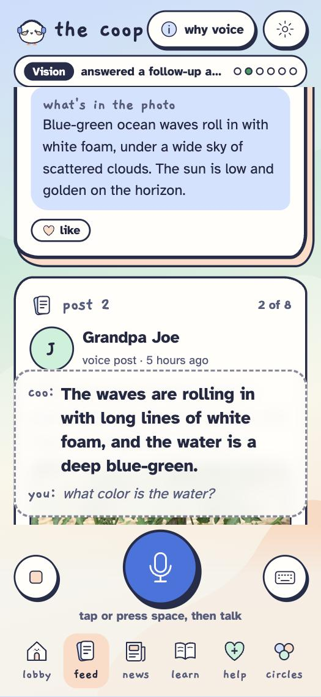<br>**Photos, if you want them** | 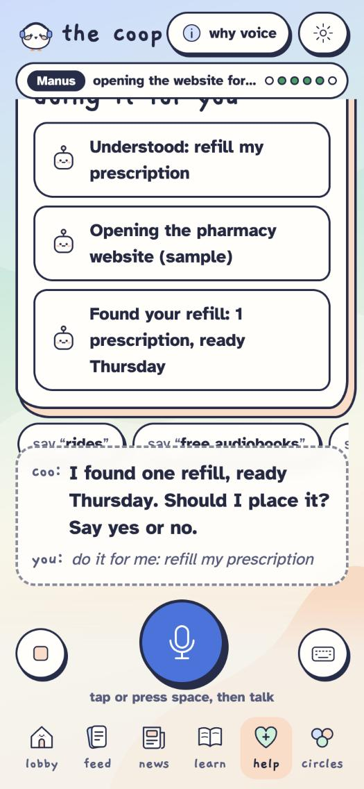<br>**Do it for me** | 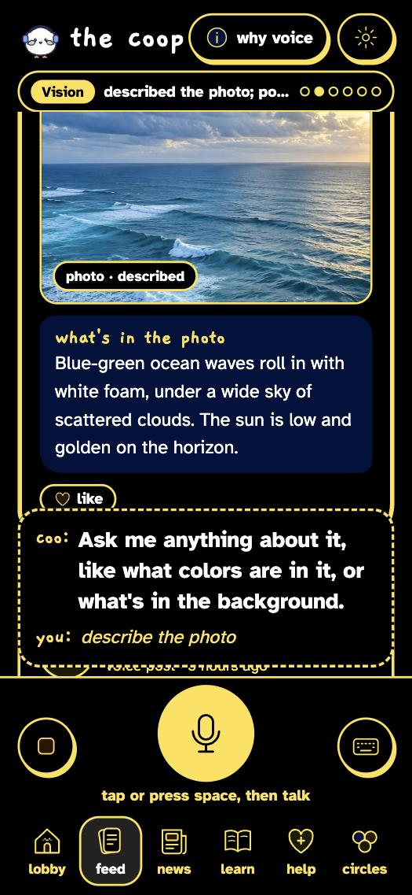<br>**High contrast** |

<div align="center">
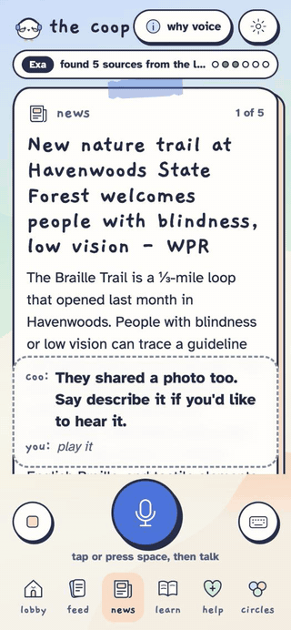
</div>

## How it works

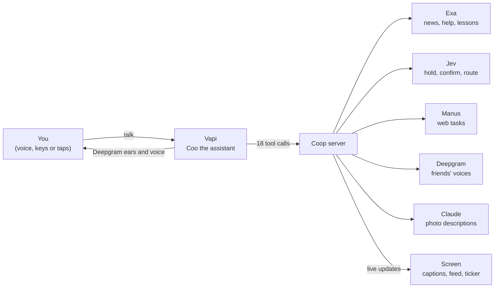

When you say "what's new?", Vapi hears you through Deepgram and Coo calls the feed tool. The server answers, the screen jumps to Maya's journey, and Coo says *"Maya, 2 hours ago."* Then Maya's own Deepgram voice plays. If anything fails, a backup voice built into the browser takes over, so the app never goes silent.

## Run it locally

```bash
npm install
cp .env.example .env   # add your keys
npm run dev            # web on :5173, server on :8787
```

Give Vapi a way to reach your laptop, then point everything at that link:

```bash
cloudflared tunnel --url http://localhost:8787
```

```bash
npm run new-tunnel -- https://your-link.trycloudflare.com
```

```bash
npm run check   # ✅ or ❌ for every sponsor in a few seconds
```

<details>
<summary><b>Environment variables</b></summary>

| Variable | What it's for |
|---|---|
| `VAPI_PRIVATE_KEY`, `VAPI_PUBLIC_KEY` | Vapi server and browser keys |
| `VAPI_PHONE_NUMBER_ID` | A phone number people can call |
| `DEEPGRAM_API_KEY` | Friends' voices and voice-post transcripts |
| `EXA_API_KEY` | Real news, help and lessons |
| `TYPESAFE_API_KEY`, `MANUS_API_KEY` | Turn on the 🧪 features |
| `ANTHROPIC_API_KEY` | Photo descriptions |

`npm run setup` saves Coo's id, the tunnel link and the tool password in `.env.local`.

</details>

## What's next

A phone number anyone can call from a landline, recording a journey right in the app, Spanish with automatic language detection, and co-designing every screen with blind and low-vision testers.

## Credits

Built at the **Side Quest Hotline** voice hackathon at **Vapi HQ** by [Arushi Nirmal](https://github.com/arushiSH5-cyber) and team. The friends in the feed and their journeys are made up. Photo credits are in [`web/public/photos/CREDITS.md`](web/public/photos/CREDITS.md).
