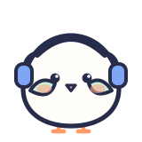
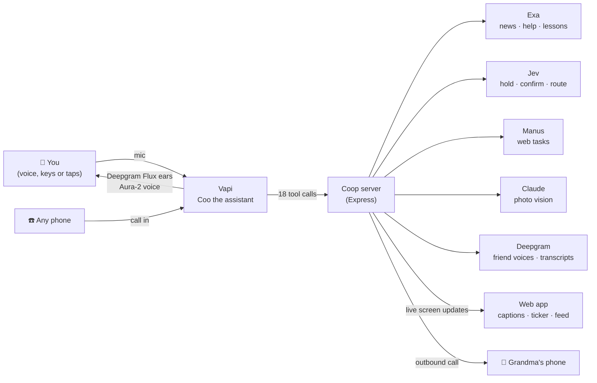
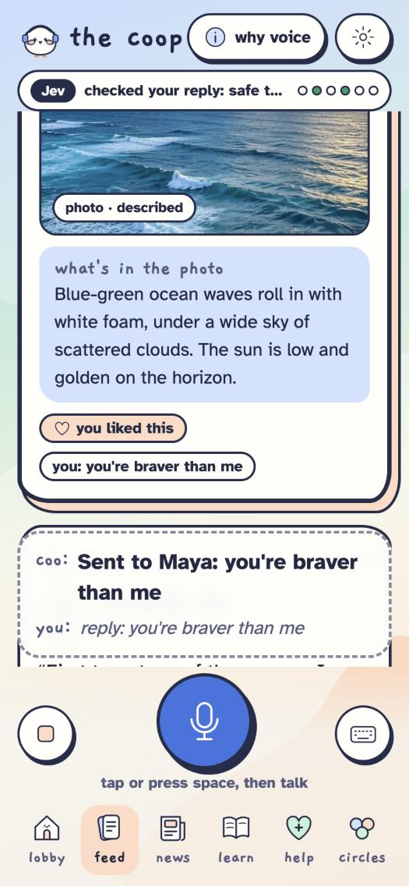
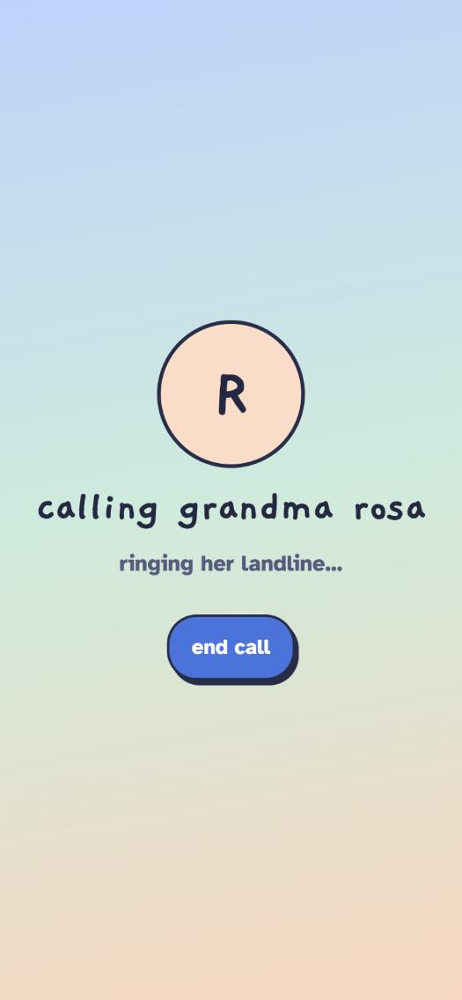

<div align="center">



# the coop

### social media you can hear 🎧

**Built first for blind, low-vision and older people. Better for everyone, like curb cuts.**

[**▶ Try the live app**](https://thecoop-kappa.vercel.app) · [How to demo it](#-try-it-in-60-seconds) · [How it works](#-how-it-works) · [Run it yourself](#-run-it-locally)

      


</div>

---

## 🙈 Close your eyes. You're our user now.

Scroll your feed. Every photo just says *"image."* Every "like" button is a hunt. That's social media for 7 million Americans with vision loss, and for millions of older adults who never learned a screen reader.

**The Coop is a social network you talk to.** Coo, a friendly pigeon, reads you your friends' posts *in their own voices*, describes every photo and answers your questions about it, reads the news with real sources, holds scams before you ever hear them, and can even phone Grandma's landline to share a photo.

No screen required. No app required. Just say *"what's new?"*

<div align="center">

</div>

## 🎤 Try it in 60 seconds

Open the app in **Chrome**, tap the big blue mic (or press **space**), and say:

| Say this | What happens |
|---|---|
| **"What's new?"** | Coo says who it's from, then Maya's post plays **in Maya's own voice** 🗣️ |
| **"Describe the photo"** | Coo looks at the *real* image and describes it |
| **"What color is the water?"** | Ask anything. Coo answers about that exact photo |
| **"Next"** | Jumps to the next friend, even while someone is still talking |
| **"Like it"** · **"Reply: you're braver than me"** | 💛 a chime, and it's on the post, checked for safety first |
| **"Go to news"** · **"More like this"** | One story at a time, outlet named out loud |
| **"Go to circles"** · **"What got blocked?"** | 🛡️ A scam post was held, so nobody had to hear it |
| **"Send this to Grandma"** | ☎️ Coo phones Grandma, describes the photo, and posts her spoken reply back |
| **"Play my feed"** | Everyone mode: your feed as a hands-free podcast while you cook or walk |

No mic? Tap the ⌨️ button and type the same words, or use the chips on screen. Every voice command also works from the keyboard.

> **Heads up for judges:** the live site's voice runs on our team laptop through a tunnel. If it's offline, The Coop switches to its **backup voice** (your browser's) with sample data, so you can still click through everything.

## ✨ What makes it different

- 🗣️ **Friends sound like friends.** Each person's post is spoken in their own Deepgram Aura-2 voice, not one robot narrator.
- 🖼️ **Photos finally talk.** Every photo gets a real description, and you can ask follow-ups. Coo never guesses who someone is.
- 📰 **Every fact has a source.** News and help come from Exa, and Coo says the outlet out loud. Help answers are limited to official sites (.gov, Library of Congress, ADA National Network).
- 🛡️ **A safe room.** Jev holds scams and harassment in support circles before anyone hears them, and asks *"are you sure?"* before anything risky.
- 🤲 **Hands for the web.** "Do it for me: refill my prescription" lets Manus click through the website, and it **always stops for your yes** before the final step.
- ☎️ **Any phone works.** Grandma doesn't need a smartphone. Coo can call her landline, and anyone can call in.
- 👀 **Sighted friends can join.** Big live captions of everything, a sponsor ticker, and any post can become a captioned share clip.

## 🧩 Sponsors, and exactly what each one does

| | What it powers in The Coop | Status |
|---|---|---|
| **Vapi** | Coo herself: the assistant, 18 tools, the web mic, interruptions, phone calls in and out | ✅ live |
| **Deepgram** | Flux speech-to-text for Coo's ears, Aura-2 voices for Coo and all 8 friends, transcripts for recorded voice posts | ✅ live |
| **Claude** (vision, not a sponsor) | Describes each real photo and answers questions about it | ✅ live |
| **Exa** | News from the last 48 hours, official help sources, beginner lessons, "more like this" | 🧪 built; shows labeled samples until our key is added |
| **TypeSafe Jev** | Moderation (allow or hold), the "are you sure?" gate, and an intent router | 🧪 built; keyword rules stand in, labeled, until our key is added |
| **Manus** | Web tasks for things that are hard with a screen reader, with a yes before the final step | 🧪 built; a labeled scripted run until our key is added |
| **AdaL** | Share clips for Instagram and TikTok | 🧪 no public video API found, so clips are made in the browser and labeled "sample" |

We'd rather show you a labeled sample than fake a live call. Anything that isn't live says **"sample"** on screen and out loud.

## 🔧 How it works



- **One voice at a time.** Coo says *"Maya, 2 hours ago"*, goes silent, and Maya's own voice plays. Say "next" mid-post and it cuts straight to the next one.
- **The screen follows the conversation.** Every tool call pushes a live update, so sighted friends see the post, the photo description, the story's source link and the sponsor ticker as Coo talks.
- **Nothing breaks the demo.** Every sponsor has a fallback, and if Vapi can't connect, a local command engine with the browser's voice takes over.

## ♿ Accessibility

- Real buttons with labels, visible focus rings, 44px+ targets, nothing shown by color alone.
- **Keyboard:** <kbd>Space</kbd> talk · <kbd>→</kbd>/<kbd>←</kbd> next/back · <kbd>D</kbd> describe · <kbd>L</kbd> like · <kbd>R</kbd> reply · <kbd>W</kbd> where am I · <kbd>H</kbd> help · <kbd>Esc</kbd> stop.
- **Settings:** high contrast, text size up to 160%, Coo's speed, expert mode (shorter replies), "use my screen reader" (Coo goes quiet and captions go to a live region), calm mode (no animation), everyone mode.
- Built to work **alongside** VoiceOver and TalkBack, not to replace them. A real product would be designed and tested with blind and low-vision users.

## 📸 Screens

| | | |
|:-:|:-:|:-:|
| <br>**Lobby** | <br>**A friend's voice post** | <br>**Photos talk** |
| <br>**Like and reply by voice** | <br>**News with sources** | <br>**Scam held in Circles** |
| <br>**Do it for me** | <br>**Calling Grandma** | <br>**High contrast** |

## 🛠 Run it locally

```bash
npm install
cp .env.example .env   # add your keys
npm run dev            # web on :5173, server on :8787
```

In a second terminal, give Vapi a way to reach the tools:

```bash
cloudflared tunnel --url http://localhost:8787
```

Then point everything at that link. This updates Coo on Vapi and redeploys the site:

```bash
npm run new-tunnel -- https://some-words.trycloudflare.com
```

```bash
npm run check   # ✅/❌ for every sponsor in a few seconds
```

Use Chrome for the mic. `npm run setup` saves Coo's id, the tunnel link and the tool password in `.env.local`, so editing `.env` can't wipe them. Only requests carrying the password can use `/tools/*`.

<details>
<summary><b>Environment variables</b></summary>

| Variable | What it's for |
|---|---|
| `VAPI_PRIVATE_KEY`, `VAPI_PUBLIC_KEY` | Vapi server and browser keys |
| `VAPI_ASSISTANT_ID` | Written by `npm run setup` |
| `VAPI_PHONE_NUMBER_ID` | Phone in and out. Calling out needs a number imported from Twilio, Vonage or Telnyx |
| `DEMO_PHONE` | The phone Coo rings, `+1XXXXXXXXXX`, belonging to someone who agreed |
| `DEEPGRAM_API_KEY` | Friend voices and voice-post transcripts |
| `EXA_API_KEY` · `TYPESAFE_API_KEY` · `MANUS_API_KEY` | Turn the 🧪 features live |
| `ANTHROPIC_API_KEY` | Photo descriptions |
| `PUBLIC_URL`, `TOOLS_SECRET` | The tunnel link and its password |

</details>

<details>
<summary><b>Project map</b></summary>

```
web/      Vite + React + TypeScript. Live captions, scrolling feed, sponsor ticker, local fallback engine
server/   Express + TypeScript. Coo's 18 tools, sponsor clients, live updates, data.json storage
scripts/  check (sponsor status), setup (create Coo on Vapi), new-tunnel (repoint everything)
thecoop.html   the original one-file prototype
```

</details>

## 🌱 What's next

Recording a photo with a voice post, letting the poster edit a photo's description, Spanish with automatic language detection, a weekly digest Coo reads you, and co-designing every screen with blind and low-vision testers.

## 💛 Credits

Built in one evening at the voice agent hackathon at **Vapi HQ** by [Arushi Nirmal](https://github.com/arushiSH5-cyber) and team. Photo credits are in [`web/public/photos/CREDITS.md`](web/public/photos/CREDITS.md). The friends in the feed are made up, and so is Grandma Rosa (sorry, Rosa). 🐦
